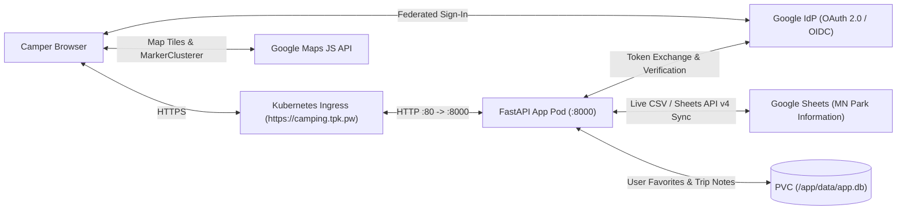

# Setup Guide (`SETUP.md`)

This guide walks you through configuring the Google Cloud credentials, Google Maps JavaScript API, Federated Google Identity Provider (OAuth 2.0 / OIDC), and Google Sheets data connection for the **Minnesota Park & Campsite Explorer** (for both `https://camping.tpk.pw` on Kubernetes/Helm and `http://localhost:8000` on Docker Compose).

---

## Architecture Overview

---

## 1. Create or Select a Google Cloud Project

1. Open the [Google Cloud Console](https://console.cloud.google.com/).
2. Click the project selector dropdown in the top bar and click **New Project** (e.g., `mn-campsite-explorer`).
3. Ensure billing is enabled on the project if you plan to use the **Google Maps JavaScript API** (Google provides a monthly free tier credit for Maps APIs).

---

## 2. Configure Google Maps JavaScript API (`GOOGLE_MAPS_API_KEY`)

The application plots all **5,584 Minnesota State Park, State Forest, Recreation Area, and Water Trail campsites** on an interactive clustered Google Map.

> **Note:** If `GOOGLE_MAPS_API_KEY` is left blank during initial setup, the app automatically falls back to an interactive OpenStreetMap / USGS Topographic / Satellite map with clustering so you can use and test the app immediately. You can also test a Google Maps API key directly inside the web UI via the **Map Settings** button in the top navigation bar.

### Steps to Obtain a Google Maps API Key:
1. In the Google Cloud Console, navigate to **APIs & Services > Library**.
2. Search for **Maps JavaScript API** and click **Enable**.
3. Navigate to **APIs & Services > Credentials**.
4. Click **+ Create Credentials > API key**.
5. Copy the generated key (`AIzaSy...`) and restrict it:
   - Under **Application restrictions**, select **HTTP referrers (web sites)** and add:
     - `https://camping.tpk.pw/*`
     - `http://localhost:8000/*`
     - `http://127.0.0.1:8000/*`
   - Under **API restrictions**, select **Restrict key** and choose **Maps JavaScript API**.
6. Set `GOOGLE_MAPS_API_KEY` in your `.env` (for Docker Compose) or pass `--set secrets.GOOGLE_MAPS_API_KEY="AIzaSy..."` to Helm.

---

## 3. Configure Federated Google IdP Login (OAuth 2.0 / OIDC)

The application supports both:
- **Google OAuth 2.0 / OpenID Connect (OIDC) Authorization Code Flow** (`/auth/login` -> `/auth/callback`)
- **Google Identity Services (Sign In With Google One-Tap / Popup Button)** (`/auth/google/token`)

Signing in unlocks personal user features stored against your Google `sub` identifier:
- Saving favorite campsites (`★ Saved` filter)
- Recording personal campsite ratings (`1–5 stars`) and trip notes
- Triggering an on-demand live re-sync from the Google Sheet (`Sync` button)

### Step 3a: Configure the OAuth Consent Screen
1. In the Google Cloud Console, go to **APIs & Services > OAuth consent screen**.
2. Choose **External** (or **Internal** if using Google Workspace) and click **Create**.
3. Fill in the required fields:
   - **App name:** `Minnesota Park & Campsite Explorer`
   - **User support email:** Your email address
   - **Authorized domains:** `tpk.pw`
   - **Developer contact information:** Your email address
4. Click **Save and Continue** through Scopes (`openid`, `.../auth/userinfo.email`, `.../auth/userinfo.profile`) and add your Google account under **Test users** if the app is in Testing mode.

### Step 3b: Create OAuth 2.0 Client Credentials
1. Navigate to **APIs & Services > Credentials**.
2. Click **+ Create Credentials > OAuth client ID**.
3. Select **Application type:** `Web application`.
4. Name it `MN Campsite Explorer Web Client`.
5. Under **Authorized JavaScript origins**, add:
   - `https://camping.tpk.pw`
   - `http://localhost:8000`
6. Under **Authorized redirect URIs**, add:
   - `https://camping.tpk.pw/auth/callback`
   - `http://localhost:8000/auth/callback`
7. Click **Create** and copy the **Client ID** and **Client Secret**:
   - **For Helm (`https://camping.tpk.pw`):** `config.GOOGLE_REDIRECT_URI` is already defaulted to `https://camping.tpk.pw/auth/callback` in [values.yaml](helm/mncampsiteapp/values.yaml). Pass `secrets.GOOGLE_CLIENT_ID` and `secrets.GOOGLE_CLIENT_SECRET` via Helm values.
   - **For Docker Compose (`http://localhost:8000`):** Set `GOOGLE_CLIENT_ID`, `GOOGLE_CLIENT_SECRET`, and `GOOGLE_REDIRECT_URI` in `.env`.

---

## 4. Configure the Minnesota Park Information Google Sheet

By default, the app is pre-configured to pull from the Minnesota Park Information Google Sheet:
- **Spreadsheet URL:** `https://docs.google.com/spreadsheets/d/1CW-0euFLFz24nzcXNrTY24IoqTX9BCHLX5fdLjxAHgk/edit?gid=459530859#gid=459530859`
- **`GOOGLE_SHEET_ID`:** `1CW-0euFLFz24nzcXNrTY24IoqTX9BCHLX5fdLjxAHgk`
- **`GOOGLE_SHEET_GID`:** `459530859`

### How Data Sync Works (3-Tier Resilience):
1. **Google Sheets API v4 (Optional):** If `GOOGLE_SHEETS_API_KEY` is provided, the backend queries `https://sheets.googleapis.com/v4/spreadsheets/{GOOGLE_SHEET_ID}/values/...`.
2. **Direct Google Sheets Live CSV Export (Default):** If `GOOGLE_SHEETS_API_KEY` is empty, the backend fetches directly from `https://docs.google.com/spreadsheets/d/1CW-0euFLFz24nzcXNrTY24IoqTX9BCHLX5fdLjxAHgk/export?format=csv&gid=459530859` and caches the parsed dataset in memory for `SHEET_CACHE_TTL_SECONDS` (default: 30 minutes).
3. **Bundled Local Snapshot Fallback:** If the container is run in an offline environment without internet access, it automatically falls back to `app/data/mn_campsites_fallback.csv` (all 5,584 campsites across 109 parks).

---

## 5. Configuration & Secrets Reference (`.env` & Helm `values.yaml`)

| Environment Variable | Helm Value Path | Default (Helm) | Description |
| :--- | :--- | :--- | :--- |
| `SESSION_SECRET_KEY` | `secrets.SESSION_SECRET_KEY` | `mn-campsite-dev-...` | Secret string used to sign session cookies (`openssl rand -hex 32`) |
| `GOOGLE_MAPS_API_KEY` | `secrets.GOOGLE_MAPS_API_KEY` | `""` | Google Maps JavaScript API key |
| `GOOGLE_CLIENT_ID` | `secrets.GOOGLE_CLIENT_ID` | `""` | OAuth 2.0 Client ID for Federated Google IdP login |
| `GOOGLE_CLIENT_SECRET` | `secrets.GOOGLE_CLIENT_SECRET` | `""` | OAuth 2.0 Client Secret for Federated Google IdP login |
| `GOOGLE_SHEETS_API_KEY` | `secrets.GOOGLE_SHEETS_API_KEY` | `""` | Optional Google Sheets API v4 key |
| `GOOGLE_REDIRECT_URI` | `config.GOOGLE_REDIRECT_URI` | `https://camping.tpk.pw/auth/callback` | OAuth 2.0 callback URL |
| `GOOGLE_SHEET_ID` | `config.GOOGLE_SHEET_ID` | `1CW-0euFLFz24nzcXNrTY24IoqTX9BCHLX5fdLjxAHgk` | Google Spreadsheet document ID |
| `GOOGLE_SHEET_GID` | `config.GOOGLE_SHEET_GID` | `459530859` | Worksheet tab GID for Minnesota Park Information |
| `SHEET_CACHE_TTL_SECONDS` | `config.SHEET_CACHE_TTL_SECONDS` | `"1800"` | Seconds to cache sheet data in memory before refreshing |
| `GOOGLE_MAPS_MAP_ID` | `config.GOOGLE_MAPS_MAP_ID` | `"DEMO_MAP_ID"` | Google Maps Map ID |
| `ENABLE_DEMO_AUTH` | `config.ENABLE_DEMO_AUTH` | `"true"` | Enables local demo login when Google OAuth is not yet configured |
| `DATABASE_PATH` | `config.DATABASE_PATH` | `"/app/data/app.db"` | Path to SQLite database inside the container |
